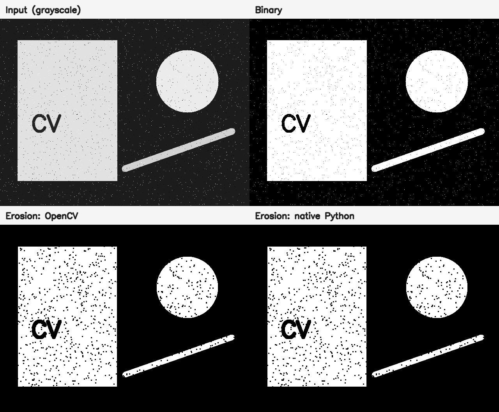
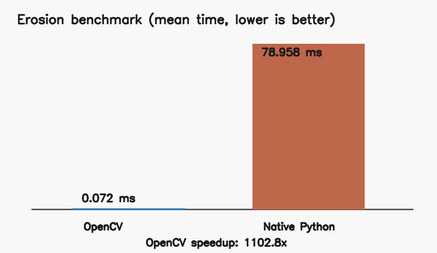

# Лабораторная работа №1 — вариант 7

## Цель и задание

Цель работы — реализовать простой алгоритм обработки изображений двумя способами и сравнить их быстродействие.

Вариант 7: **эрозия бинарного изображения прямоугольным структурирующим элементом 3×3**. Реализованы:

1. библиотечный вариант на OpenCV (`cv2.erode`);
2. нативный вариант на Python с явным обходом пикселей и окрестности 3×3.

Бинаризация выполняется библиотечной функцией, что разрешено условием варианта.

## Теоретическая база

Математическая морфология изучает преобразования изображения с помощью структурирующего элемента. Для множества пикселей переднего плана `A` и структурирующего элемента `B` эрозия определяется как

```text
A ⊖ B = { z | B, сдвинутое в z, полностью содержится в A }.
```

Для бинарного изображения, где передний план имеет значение 255, эрозия ядром 3×3 оставляет пиксель белым только тогда, когда все существующие пиксели его окрестности 3×3 белые. Эквивалентная форма для полутонового изображения — минимум по окрестности:

```text
dst(x, y) = min src(x + dx, y + dy),  dx, dy ∈ {-1, 0, 1}.
```

Поэтому граница белых объектов сдвигается внутрь приблизительно на один пиксель за одну итерацию, тонкие белые детали и одиночный белый шум исчезают, а чёрные области расширяются.

В обеих реализациях пиксели за пределами изображения считаются белыми (`borderValue=255`). Это нейтральное значение для операции минимума и исключает искусственное разрушение объекта только из-за соприкосновения с рамкой изображения.

## Описание системы

Программа имеет единый конвейер:

```text
изображение → оттенки серого → бинаризация → две реализации эрозии
                                           ↓
                       проверка идентичности результатов
                                           ↓
                    замеры времени и сохранение артефактов
```

Основные компоненты файла `lab1_variant7.py`:

- `binarize` — пороговая бинаризация средствами OpenCV;
- `erode_opencv` — вызов оптимизированной функции OpenCV с ядром 3×3;
- `erode_native` — последовательное применение собственного алгоритма;
- `benchmark` — прогрев и серия замеров через монотонный высокоточный таймер `time.perf_counter_ns`;
- `run_self_tests` — проверка известного результата, обработки границ и совпадения реализаций на детерминированных случайных данных.

После обработки программа требует полного попиксельного совпадения результатов через `numpy.array_equal`. При расхождении выполнение завершается с ошибкой.

## Установка и запуск

Требуется Python 3.9 или новее.

```bash
python3 -m venv .venv
source .venv/bin/activate
python3 -m pip install -r requirements.txt
```

Запуск на встроенном воспроизводимом изображении и одновременное выполнение тестов:

```bash
python3 lab1_variant7.py --self-test --repeats 7
```

Запуск на своём изображении:

```bash
python3 lab1_variant7.py \
  --input /путь/к/изображению.png \
  --threshold 127 \
  --iterations 1 \
  --repeats 7 \
  --output-dir results
```

Параметры:

- `--input` — путь к исходному изображению; без параметра создаётся детерминированный пример 640×480;
- `--threshold` — порог бинаризации от 0 до 255, по умолчанию 127;
- `--iterations` — число последовательных применений эрозии, по умолчанию 1;
- `--repeats` — число измерений каждой реализации, по умолчанию 5;
- `--output-dir` — каталог результатов, по умолчанию `results`;
- `--self-test` — выполнить встроенные тесты до обработки изображения.

## Результаты и тестирование

Контрольный запуск выполнен на детерминированном изображении 640×480 с порогом 127, одной итерацией эрозии и семью измерениями каждой реализации. Окружение запуска: macOS 26.2 arm64, Python 3.12.14, OpenCV 4.14.0, NumPy 2.5.4.





Результаты контрольного запуска:

| Реализация | Минимум, мс | Медиана, мс | Среднее, мс | Стандартное отклонение, мс |
|---|---:|---:|---:|---:|
| OpenCV | 0,065 | 0,066 | 0,072 | 0,014 |
| Нативный Python | 78,774 | 78,846 | 78,958 | 0,184 |

Реализации совпали для всех 307 200 пикселей: `difference.png` полностью чёрный, число различающихся пикселей равно 0. После эрозии количество белых пикселей уменьшилось со 116 668 до 106 417, что соответствует сужению переднего плана. В этом запуске OpenCV оказался примерно в 1102,8 раза быстрее нативного Python. Полные данные сохранены в `results/benchmark.csv` и `results/summary.json`.

Система сохраняет:

- входное полутоновое и бинарное изображения;
- результаты обеих реализаций;
- абсолютную разницу результатов (`difference.png`);
- сводную иллюстрацию и график быстродействия;
- таблицу замеров CSV и метаданные JSON.

## Выводы

Нативная реализация непосредственно демонстрирует определение эрозии: для каждого пикселя проверяется окрестность 3×3, а обнаружение хотя бы одного чёрного соседа позволяет досрочно записать 0. Её результат полностью совпал с OpenCV на контрольном изображении и во встроенных тестах, включая изображения малых размеров, обработку границ и несколько итераций.

OpenCV выполняет ту же операцию в оптимизированном нативном коде и в контрольном запуске дал ускорение примерно в 1102,8 раза. Конкретный коэффициент зависит от оборудования, версии библиотек, изображения и параметров; устойчивый вывод состоит в том, что библиотечная реализация существенно быстрее явных циклов интерпретатора Python.

## Использованные источники

1. [OpenCV — Morphological Transformations](https://docs.opencv.org/4.x/d9/d61/tutorial_py_morphological_ops.html).
2. [OpenCV — описание `cv::erode`](https://docs.opencv.org/4.x/d4/d86/group__imgproc__filter.html).
3. [Python — `time.perf_counter_ns`](https://docs.python.org/3/library/time.html#time.perf_counter_ns).
